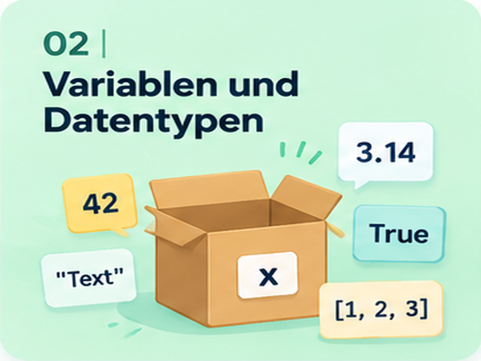
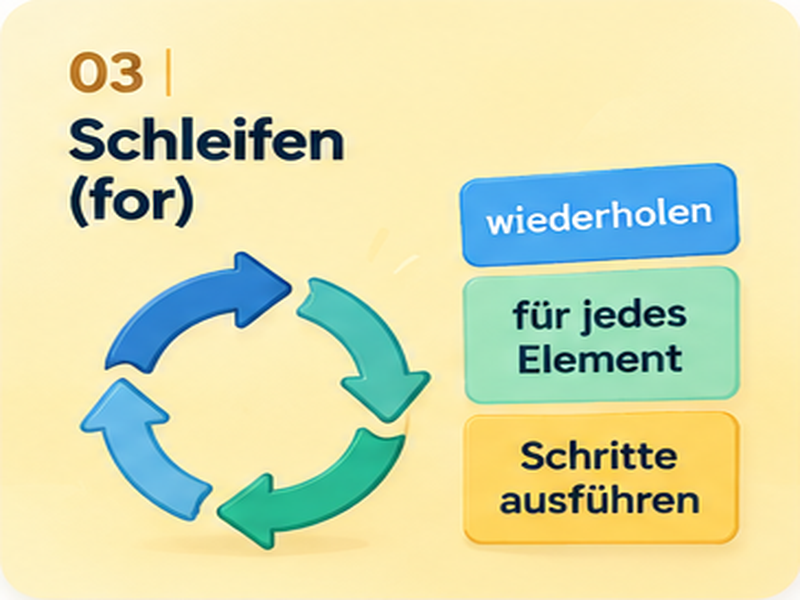
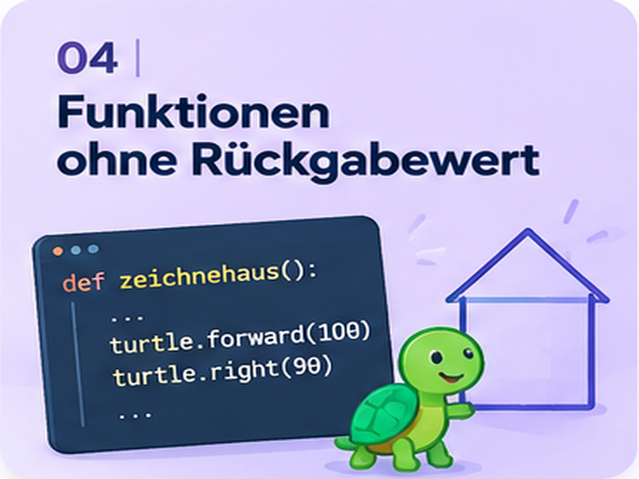
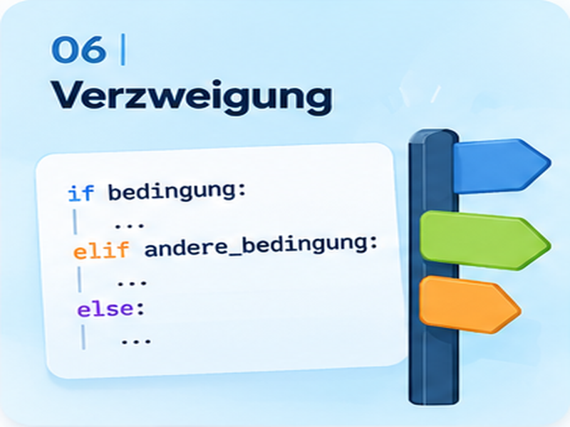
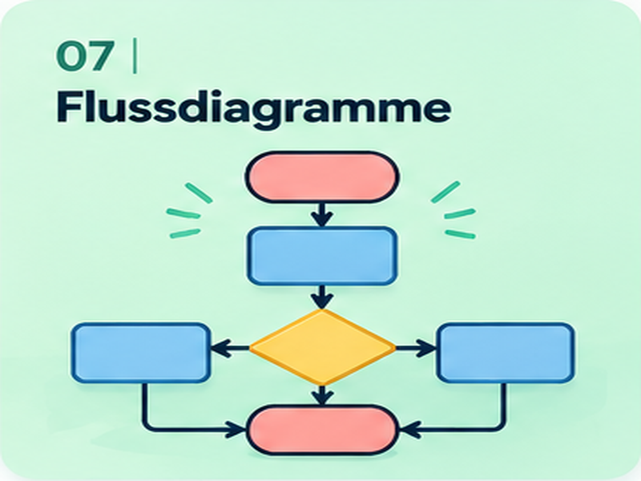
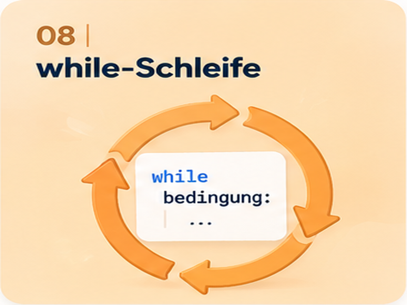
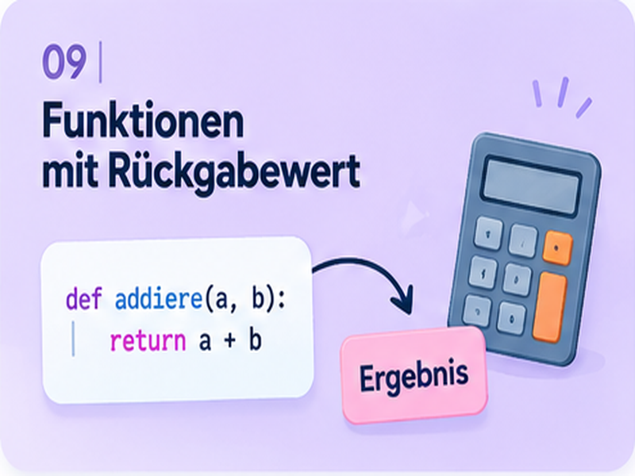
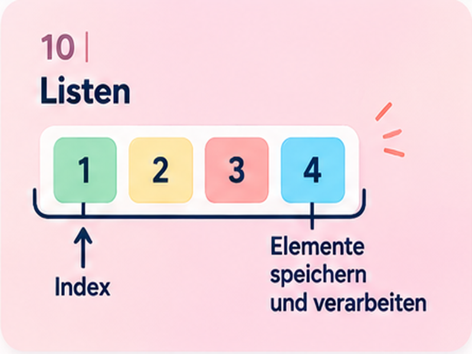
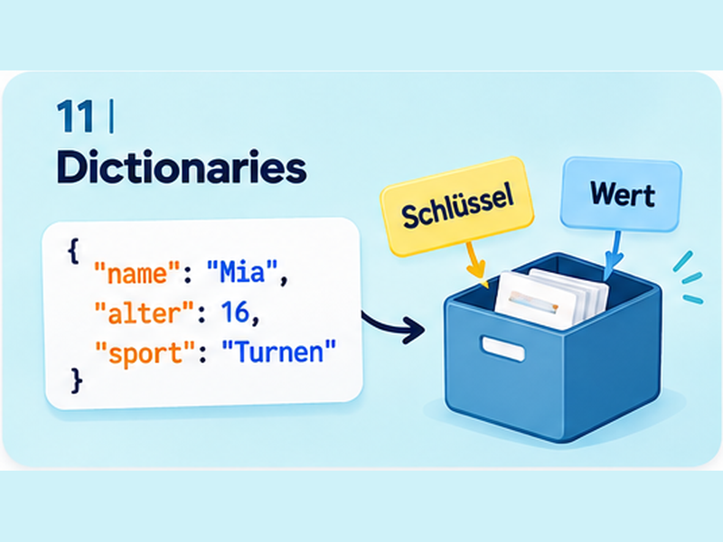

  <header class="course-hero">
    
Informatik · Python

    <h1>Programmieren lernen.</h1>
    
Entdecke Python Schritt für Schritt: von den ersten Anweisungen bis zu eigenen Programmen. Mit anschaulichen Erklärungen, Beispielen und Aufgaben zum Üben.

  </header>
  <h2 class="course-section-title">Kapitel entdecken</h2>
  

  <a class="chapter-card" href="einfuehrung/">
    

      
    

    

      <h3>Einführung</h3>
      
Algorithmen, Programmiersprachen und erste Schritte.

    

  </a>
  <a class="chapter-card" href="variablen-und-datentypen/">
    

      
    

    

      <h3>Variablen und Datentypen</h3>
      
Werte speichern, verändern und ausgeben.

    

  </a>
  <a class="chapter-card" href="schleifen/">
    

      
    

    

      <h3>for-Schleife</h3>
      
Anweisungen gezielt wiederholen.

    

  </a>
  <a class="chapter-card" href="funktionen-ohne-rueckgabewert/">
    

      
    

    

      <h3>Funktionen ohne Rückgabewert</h3>
      
Eigene Befehle definieren und verwenden.

    

  </a>
  <a class="chapter-card" href="bedingungen/">
    

      
    

    

      <h3>Bedingungen</h3>
      
Mit Vergleichen und Wahrheitswerten arbeiten.

    

  </a>
  <a class="chapter-card" href="verzweigung/">
    

      
    

    

      <h3>Verzweigung</h3>
      
Entscheidungen mit if und else treffen.

    

  </a>
  <a class="chapter-card" href="flussdiagramme/">
    

      
    

    

      <h3>Flussdiagramme</h3>
      
Algorithmen übersichtlich darstellen.

    

  </a>
  <a class="chapter-card" href="while-schleife/">
    

      
    

    

      <h3>while-Schleife</h3>
      
Wiederholen, solange eine Bedingung gilt.

    

  </a>
  <a class="chapter-card" href="funktionen/">
    

      
    

    

      <h3>Funktionen mit Rückgabewert</h3>
      
Ergebnisse berechnen und zurückgeben.

    

  </a>
  <a class="chapter-card" href="listen/">
    

      
    

    

      <h3>Listen</h3>
      
Mehrere Werte gemeinsam verwalten.

    

  </a>
  <a class="chapter-card" href="dictionaries/">
    

      
    

    

      <h3>Dictionaries</h3>
      
Informationen mit Schlüsseln organisieren.

    

  </a>
  

  
Zum Nachschlagen: <a href="cheatsheet/">Python-Cheatsheet ansehen →</a>

